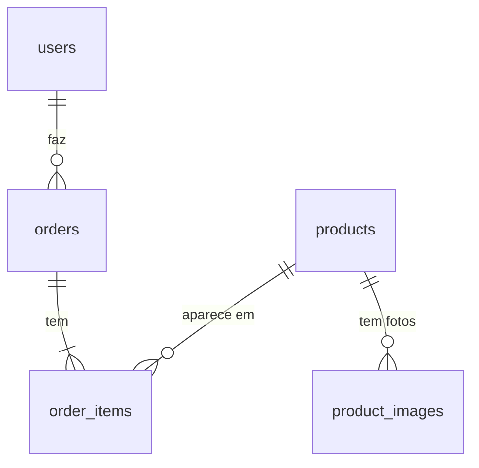

# Edy Store 

Loja virtual de tênis, projeto final da Digital College. O repositório tem duas partes:

| Parte | Pasta | Tecnologias |
|---|---|---|
| **Front-end** (o site) | raiz do projeto (`src/`, `public/`) | React 18, Vite, React Router, CSS puro |
| **Back-end** (a API) | [`backend/`](backend/README.md) | Node, Express, SQLite com migrations, JWT, Swagger |

> **Site publicado (front-end):** https://edy-store-peach.vercel.app/
>
> **Repositório:** https://github.com/EdvanilsonBS/Edy-Store

---

## Sumário

1. [Visão geral](#visão-geral)
2. [Como rodar o projeto](#como-rodar-o-projeto)
3. [Front-end](#front-end)
4. [Back-end](#back-end)
5. [Testes](#testes)
6. [Publicação (deploy)](#publicação-deploy)
7. [Requisitos atendidos](#requisitos-atendidos)
8. [Limitações e próximos passos](#limitações-e-próximos-passos)
9. [Onde editar o quê](#onde-editar-o-quê)
---

## Visão geral

O cliente navega pelos produtos, filtra e busca, escolhe tamanho e cor, coloca na sacola e finaliza a compra (precisa estar logado para finalizar). Acompanha os pedidos na página **Meus Pedidos**.

O front-end segue o layout e a documentação do projeto base
[`digitalcollegebr/projeto-digital-store`](https://github.com/digitalcollegebr/projeto-digital-store).
O back-end é uma API REST própria, com CRUD completo, autenticação, autorização por perfil, banco relacional com migrations e documentação Swagger.


---

## Como rodar o projeto

**Pré-requisitos:** [Node.js](https://nodejs.org/) **22.15 ou mais novo** (confira com `node -v`). O back-end usa o SQLite que já vem no Node; o front funciona também em versões anteriores.

Use **dois terminais**, um para cada parte.

### Front-end (terminal 1)

```bash
npm install
npm run dev        # http://localhost:5173
```

| Comando | O que faz |
|---|---|
| `npm run dev` | servidor de desenvolvimento |
| `npm run build` | gera a versão de produção em `dist/` |
| `npm run preview` | serve a versão de produção localmente |

> Abra sempre pelo endereço do `npm run dev`. Abrir o `index.html` direto (ou pelo Live Server) mostra a página em branco.

### Back-end (terminal 2)

```bash
cd backend
npm install
copy .env.example .env      # no Mac/Linux: cp .env.example .env
npm run dev                 # http://localhost:3333/api
```

Antes de subir, abra `backend/.env` e preencha `JWT_SECRET` (um texto longo e aleatório) e `ADMIN_EMAIL` (o e-mail que será administrador). A documentação interativa fica em **http://localhost:3333/api/docs**.
Detalhes completos no [README do back-end](backend/README.md).

---

## Front-end

### Páginas

| Rota | Página | O que tem |
|---|---|---|
| `/` | Home | Carrossel com troca automática (vai e volta), coleções em destaque e produtos em alta |
| `/products` (e `/produtos`) | Listagem | Ordenação, filtros (marca, categoria, gênero, estado), busca e total de produtos |
| `/product/:id` | Produto | Galeria com miniaturas, preço, avaliação, escolha de tamanho e cor, botão COMPRAR e recomendados |
| `/categories` | Categorias | Cards das categorias; clicar leva à listagem já filtrada |
| `/cart` | Sacola | Itens, quantidades, total e a pergunta "Deseja continuar comprando?" |
| `/orders` | Meus Pedidos | Pedidos do usuário com status, itens e total (exige login) |
| `/login` e `/signup` | Login e Cadastro | Formulários com validação e mensagens de erro |

Os links do rodapé (Sobre, Blog etc.) abrem uma página provisória.

### Fluxo de compra

1. Na página do produto, escolher **tamanho** e **cor** e clicar em **COMPRAR** (sem as duas escolhas, aparece um aviso).
2. O produto vai para a **sacola**, que pergunta **"Deseja continuar comprando?"**: *sim* volta aos produtos; *não, finalizar compra* cria o pedido.
3. A sacola funciona sem login, mas **finalizar exige login**: quem não está logado passa pela tela de login e volta para a sacola. Assim todo pedido fica ligado a uma pessoa identificada.
4. O **ícone do carrinho** leva para Meus Pedidos; a bolinha mostra quantos itens estão na sacola.

### Funcionalidades

- **Busca** no cabeçalho (ignora acentos e maiúsculas; procura em nome, marca, categoria e gênero).
- **Filtros:** marca, categoria e gênero combinam com "OU" dentro do grupo e "E" entre grupos; o estado (novo/usado) é uma escolha única.
- **Ordenar por** menor ou maior preço (considera o preço com desconto).
- **Galeria** com setas, miniaturas e troca automática na Home.
- **Layout responsivo** para celular e tablet.

### Estrutura de pastas do front

```
src/
├── components/   # Header, Footer, Logo, Section, ProductCard, ProductListing,
│                 # Gallery, FilterGroup, ProductOptions, BuyBox, Info, FormField
├── pages/        # Layout, Home, Listagem, Produto, Categorias, Sacola, Pedidos, Login, Cadastro
├── context/      # AuthContext (login) e CartContext (sacola)
├── data/         # products.js e orders.js (dados do site)
├── utils/        # formatação, filtros, validações e acesso ao localStorage
├── assets/       # logos e ícones
├── App.jsx       # rotas
└── main.jsx
public/           # imagens dos produtos, coleções, slides e ícone da aba
```

---

## Back-end

API REST em Node + Express, organizada em camadas (rotas → controllers → services → models).

**Recursos principais**
- **CRUD completo** de produtos, pedidos e usuários.
- **Autenticação** com JWT e senhas protegidas com `bcrypt`.
- **Autorização por perfil:** cliente (`user`) e administrador (`admin`). Só o admin cria, edita e exclui produtos, vê todos os pedidos e muda o status deles.
- **Banco SQLite relacional** com chaves estrangeiras, índices e **migrations** em `backend/migrations/`.
- **Preço calculado no servidor:** o valor do pedido nunca vem do front.
- **Tratamento de erros** com códigos HTTP corretos (400, 401, 403, 404, 409, 413, 429, 500) e mensagens em JSON.
- **Documentação Swagger** em `/api/docs`.

### Endpoints (resumo)

| Recurso | Operações |
|---|---|
| `/api/auth` | `POST /signup`, `POST /login`, `GET /me` |
| `/api/users` | `GET/PATCH/DELETE /me`; admin: `GET /`, `DELETE /:id` |
| `/api/products` | `GET /`, `GET /:id`, `GET /filters`, `GET /categories`; admin: `POST /`, `PUT /:id`, `PATCH /:id`, `DELETE /:id` |
| `/api/orders` | `GET /`, `POST /`, `GET /:id`, `DELETE /:id`; admin: `PATCH /:id/status` |

A tabela completa, com permissões e exemplos, está em [`backend/README.md`](backend/README.md) e no Swagger.

### Modelagem do banco



O item do pedido **copia** nome, foto e preço do produto no momento da compra: o pedido não muda se o produto for editado e continua existindo se ele for excluído.

---

## Testes

Back-end (usa um banco temporário, não mexe nos seus dados):

```bash
cd backend
npm test
```

Cobrem produtos (listar, filtrar, criar, editar, excluir), cadastro e login, permissões de cliente e admin, pedidos (cálculo de preço no servidor, status, cancelamento), usuários, migrations e Swagger. Resultado esperado: `# pass 16` e `# fail 0`.

Front-end: testado manualmente nas páginas e fluxos descritos acima, em tela grande e em celular.

---

## Publicação (deploy)

- **Front-end:** publicado na Vercel (https://edy-store-peach.vercel.app/). O arquivo `vercel.json` redireciona todas as rotas para o `index.html`, para que endereços como `/products` funcionem ao recarregar a página. Cada `git push` na branch principal publica de novo.
- **Back-end:** precisa de um serviço que rode Node (Render, Railway etc.). Variáveis: `NODE_ENV=production`, `JWT_SECRET`, `CORS_ORIGIN` (com o endereço do site) e `ADMIN_EMAIL`. Em planos gratuitos o disco costuma ser apagado a cada novo deploy, então os dados do SQLite podem sumir; para dados permanentes use disco persistente ou troque os `models/` por PostgreSQL.

---

## Requisitos atendidos

**Back-end**

| Requisito | Como foi atendido |
|---|---|
| Endpoints corretos | Rotas REST para autenticação, usuários, produtos e pedidos |
| CRUD completo | Produtos, pedidos e usuários têm criar, ler, atualizar e excluir |
| Autenticação e autorização | JWT + perfis `user` e `admin` (rotas protegidas e rotas só de admin) |
| Erros e códigos HTTP | Respostas `{ "error": "..." }` com 400, 401, 403, 404, 409, 413, 429 e 500 |
| Código limpo e comentado | Arquivos com comentário no topo; separação em camadas (padrão MVC com services) |
| Modelagem e migrations | Banco relacional com FKs, `CHECK`s e 3 migrations versionadas |
| Consultas eficientes | Filtros em SQL com índices; fotos e itens buscados em uma consulta só (sem N+1) |
| Documentação da API | Swagger em `/api/docs` e tabela de endpoints no README |
| Guia de setup | Seção "Como rodar" aqui e no `backend/README.md` |

**Front-end**

| Requisito | Como foi atendido |
|---|---|
| React com componentes e rotas | Componentes reutilizáveis e React Router |
| Páginas Home, Listagem e Produto | Implementadas, além de Categorias, Sacola, Pedidos, Login e Cadastro |
| Busca, filtros e ordenação | Funcionando na listagem |
| Layout responsivo | Ajustado para celular e tablet |
| Link do repositório e integrantes | No topo deste README |

---

## Limitações e próximos passos

- **O front-end ainda usa dados do próprio site** (`src/data/products.js`) e login simulado no `localStorage`; ele ainda não consome a API do `backend/`. O próximo passo é ligar os dois: trocar produtos por `fetch('/api/products')`, o `AuthContext` por `/api/auth/*` (guardando o token) e a finalização da compra por `POST /api/orders`. Ao fazer isso, retire os pedidos de exemplo do front, porque a numeração da API começa em `2026-0001`.
- Não há pagamento real nem cálculo de frete.
- Os links institucionais do rodapé são páginas provisórias.
- O limite de tentativas de login fica na memória do servidor (zera ao reiniciar).

---

## Onde editar o quê

Todos os arquivos têm um comentário no topo explicando o que fazem.

| Quero... | Edite |
|---|---|
| Produtos, slides e coleções | `src/data/products.js` |
| Pedidos de exemplo | `src/data/orders.js` |
| Limite de unidades por item / sacola | `src/context/CartContext.jsx` |
| O que acontece ao clicar em COMPRAR | `handleBuy` em `src/pages/ProductViewPage.jsx` |
| Cores do site | variáveis no início de `src/index.css` |
| Menu do cabeçalho | lista `navLinks` em `src/components/Header/index.jsx` |
| Textos, links e redes sociais do rodapé | `src/components/Footer/index.jsx` |
| Textos e campos de login e cadastro | `src/pages/LoginPage.jsx` e `src/pages/SignupPage.jsx` |
| Visual das telas de login e cadastro | `src/pages/AuthPage.css` |
| Troca automática do carrossel | `autoPlay` em `src/pages/HomePage.jsx` |
| Nome da aba e ícone do navegador | `index.html` (ícone em `public/`) |
| Logo e ícones | arquivos em `src/assets` |
| Imagens dos produtos | arquivos em `public/` (e os caminhos em `products.js`) |
| Regras do back-end (preço, permissões) | `backend/src/services/` |
| Estrutura do banco | novo arquivo em `backend/migrations/` |
