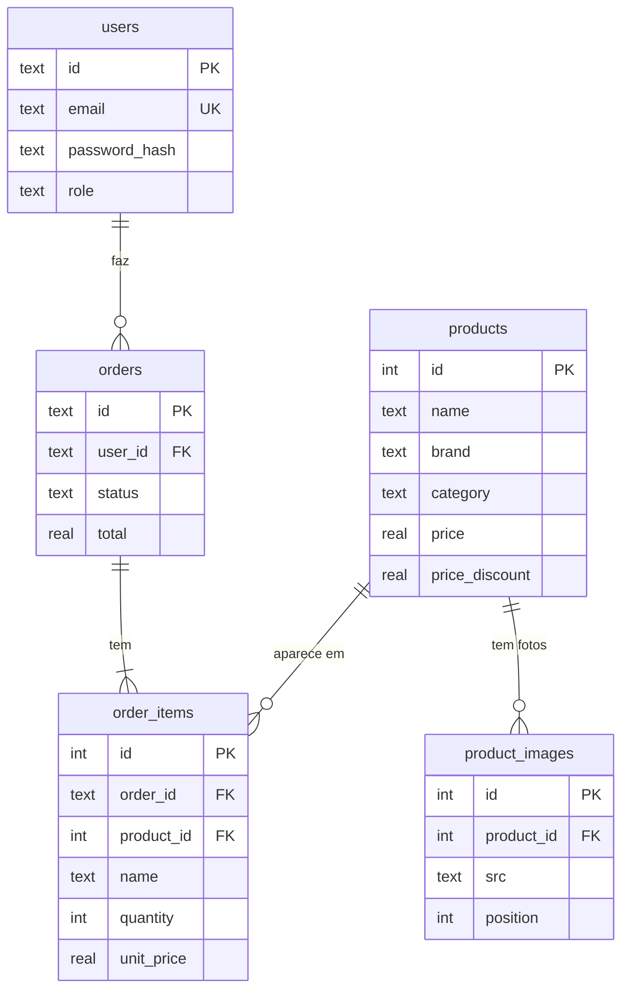

# Edi-store: back-end

API REST em **Node + Express** com banco **SQLite** (arquivo, sem nada para instalar), autenticação **JWT**, autorização por perfil (cliente/administrador), **migrations** em SQL e documentação **Swagger**.

## Guia de setup

**Pré-requisito:** Node **22.13 ou mais novo** (`node -v` mostra a versão). O banco usa o SQLite que já vem dentro do Node.

```bash
cd backend
npm install
cp .env.example .env     # no Windows: copy .env.example .env
# abra o .env e preencha JWT_SECRET (um texto longo e aleatório) e ADMIN_EMAIL (seu e-mail)
npm run dev              # http://localhost:3333/api   (em produção: npm start)
```

Na primeira execução a API cria sozinha o arquivo do banco (`data/edi-store.db`), aplica as migrations e carrega os 12 produtos de `src/data/products.seed.json`.

| Comando | O que faz |
|---|---|
| `npm run dev` | sobe a API e reinicia ao salvar um arquivo |
| `npm start` | sobe a API (produção) |
| `npm run migrate` | aplica as migrations pendentes e lista as que já rodaram |
| `npm test` | roda os testes (usam um banco temporário, não mexem no seu `data/`) |

### Variáveis de ambiente (`.env`)

| Variável | Para que serve |
|---|---|
| `PORT` | porta da API (3333) |
| `JWT_SECRET` | segredo que assina os tokens. Em produção a API **não sobe** sem ele |
| `JWT_EXPIRES_IN` | validade do login (ex.: `7d`) |
| `CORS_ORIGIN` | endereços do front liberados, separados por vírgula (inclua o da Vercel ao publicar) |
| `DB_FILE` | arquivo do banco (`data/edi-store.db`) |
| `ADMIN_EMAIL` | quem se cadastra (ou já está cadastrado) com este e-mail vira administrador |
| `AUTH_RATE_LIMIT` | máximo de tentativas de login/cadastro por IP a cada 15 min |

> **Veio da versão com `data/db.json`?** Troque `DB_FILE` no `.env` para `data/edi-store.db`, ou deixe como está: se o arquivo for o JSON antigo, a API guarda uma cópia (`db.json.legacy.json`) e importa os usuários e pedidos para o SQLite automaticamente.

## Documentação da API (Swagger)

Com a API rodando, abra **http://localhost:3333/api/docs**. É uma página interativa onde dá para ler e **testar** todos os endpoints.
Para as rotas com login: faça `POST /auth/login`, copie o `token` da resposta, clique em **Authorize** e cole.
A especificação (OpenAPI 3) está em `src/docs/openapi.js`; o JSON dela em `/api/docs/openapi.json`.

## Perfis e permissões

| Perfil | Pode |
|---|---|
| Visitante | ver produtos, filtros e categorias; cadastrar-se e entrar |
| Cliente (`user`) | tudo do visitante + criar pedidos, ver os seus, cancelar os seus em processamento, editar/excluir a própria conta |
| Administrador (`admin`) | tudo do cliente + criar/editar/excluir produtos, ver todos os pedidos, mudar o status deles, listar/excluir usuários |

O administrador é definido pelo `ADMIN_EMAIL` do `.env`: cadastre-se com esse e-mail (`POST /api/auth/signup`) e você já entra como admin.

## Endpoints

Rotas marcadas com 🔒 exigem `Authorization: Bearer <token>`; 👑 exigem também ser administrador.

| Método | URL | Acesso | O que faz |
|---|---|---|---|
| GET | `/api/health` | livre | teste rápido |
| POST | `/api/auth/signup` | livre | `{ name, email, password }` → `201 { user, token }` |
| POST | `/api/auth/login` | livre | `{ email, password }` → `{ user, token }` |
| GET | `/api/auth/me` | 🔒 | usuário logado |
| GET | `/api/users/me` | 🔒 | a própria conta |
| PATCH | `/api/users/me` | 🔒 | `{ name?, password? }` edita o perfil |
| DELETE | `/api/users/me` | 🔒 | exclui a própria conta (e os pedidos dela) → `204` |
| GET | `/api/users` | 👑 | lista os usuários |
| DELETE | `/api/users/:id` | 👑 | exclui um usuário → `204` |
| GET | `/api/products` | livre | lista. Query: `search`, `brand`, `category`, `gender`, `state`, `sort` (`price_asc`, `price_desc`, `name`) |
| GET | `/api/products/:id` | livre | um produto |
| GET | `/api/products/filters` | livre | marcas, categorias, gêneros e estados |
| GET | `/api/products/categories` | livre | categorias com a quantidade |
| POST | `/api/products` | 👑 | cria produto → `201` |
| PUT | `/api/products/:id` | 👑 | substitui o produto inteiro |
| PATCH | `/api/products/:id` | 👑 | muda só os campos enviados (`"priceDiscount": null` remove o desconto) |
| DELETE | `/api/products/:id` | 👑 | exclui → `204` (pedidos antigos continuam existindo) |
| GET | `/api/orders` | 🔒 | pedidos do usuário (novos primeiro). `?all=true` lista todos (👑) |
| POST | `/api/orders` | 🔒 | `{ items: [{ productId, size, color, quantity }] }` → `201` |
| GET | `/api/orders/:id` | 🔒 | um pedido (do dono ou admin) |
| PATCH | `/api/orders/:id/status` | 👑 | `{ status }`: `processing`, `shipping` ou `delivered` |
| DELETE | `/api/orders/:id` | 🔒 | cliente cancela se estiver `processing`; admin exclui qualquer um → `204` |

**Respostas de erro** são sempre `{ "error": "mensagem" }`, com o código HTTP certo:
`400` dados inválidos · `401` sem login/token inválido · `403` sem permissão · `404` não encontrado · `409` conflito (e-mail repetido, pedido que não pode mais ser cancelado) · `413` corpo grande demais · `429` muitas tentativas · `500` erro interno.

## Banco de dados

SQLite em `data/edi-store.db`. A estrutura é criada pelos arquivos de **`migrations/`**, aplicados uma única vez e em ordem (ficam registrados na tabela `schema_migrations`):

| Migration | O que faz |
|---|---|
| `001_create_tables.sql` | cria `users`, `products`, `product_images`, `orders`, `order_items` (com chaves estrangeiras e regras `CHECK`) |
| `002_create_indexes.sql` | índices para os filtros da loja e para "meus pedidos" |
| `003_create_order_counters.sql` | contador dos números de pedido por ano (nunca repete um número) |

Para mudar o banco no futuro, **crie um arquivo novo** (`004_...sql`) e rode `npm run migrate`. Nunca edite um que já rodou.



Decisões de modelagem:
- `order_items` **copia** nome, foto e preço do produto na hora da compra: o pedido não muda se o produto for editado e continua existindo se ele for excluído (`product_id` vira `NULL`).
- Apagar um usuário apaga os pedidos dele (`ON DELETE CASCADE`); apagar um produto apaga as fotos dele.
- Os filtros rodam em SQL (`WHERE ... IN (...)`) com índices; a busca sem acento usa a coluna `search_text`. As fotos de vários produtos/pedidos são buscadas numa única consulta (sem N+1).
- Senhas só existem como hash `bcrypt`. O preço do pedido é sempre calculado no servidor.

## Estrutura (src/)

Padrão em camadas (MVC com *services*): a requisição entra pela **rota**, o **controller** a lê, o **service** aplica as regras e o **model** conversa com o banco.

| Pasta | Papel |
|---|---|
| `config/` | variáveis de ambiente (`env.js`), conexão e migrations (`database.js`), preparação do banco (`init.js`) |
| `routes/` | URLs e qual controller atende cada uma (`docsRoutes.js` serve o Swagger) |
| `controllers/` | lê a requisição e devolve a resposta |
| `services/` | regras de negócio (validações, cálculo de preço, permissões) |
| `models/` | acesso aos dados em SQL (único lugar a trocar se mudar de banco) |
| `middlewares/` | login (JWT) e perfil admin, erros, limite de tentativas |
| `docs/` | especificação OpenAPI usada pelo Swagger |
| `../migrations/` | arquivos SQL que montam o banco |
| `../tests/` | testes automatizados (`node --test`) |

## Ligando ao front
Hoje o front usa dados mockados e login no localStorage. Para usar a API, troque:
`data/products.js` por `fetch('/api/products')`, `AuthContext` por `/api/auth/*` (guardando o `token`),
e `saveUserOrder` do carrinho por `POST /api/orders`. A sacola pode continuar no navegador.
Ao usar a API, retire os pedidos de exemplo do front (`#2026-0001` a `#2026-0003`), pois os números da API começam em `2026-0001`.

## Publicar (deploy)
A Vercel hospeda só o front. Para o back-end use um serviço de Node (Render, Railway...): defina `NODE_ENV=production`, `JWT_SECRET`, `CORS_ORIGIN` (com o endereço do site) e `ADMIN_EMAIL`. O arquivo SQLite fica no disco do servidor: em planos gratuitos o disco costuma ser apagado a cada novo deploy, então os dados podem sumir. Para dados permanentes use um disco persistente ou troque os `models/` por PostgreSQL.
